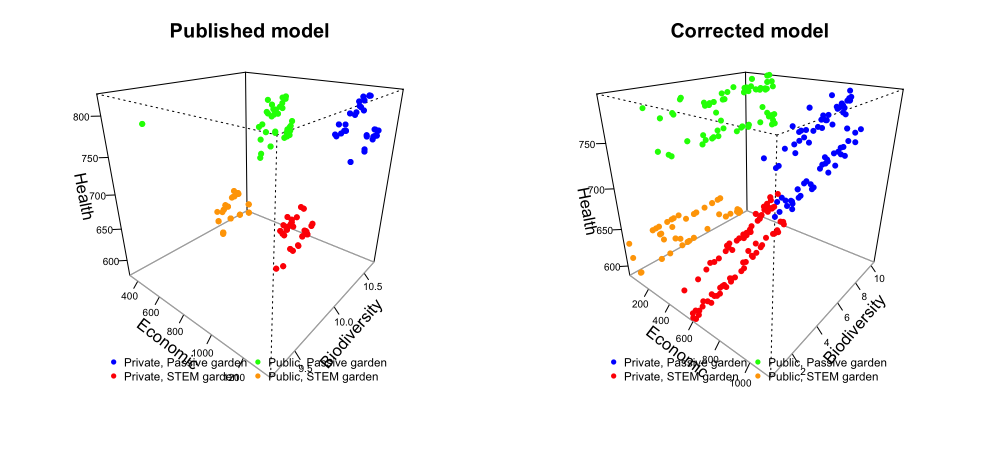

```{r setup, include = FALSE}
knitr::opts_chunk$set(echo = TRUE, message = FALSE, warning = FALSE)
source("functions/load_all.R")
library(ggplot2)
dir.create("outputs/pareto", recursive = TRUE, showWarnings = FALSE)
```

The manuscript's multi-objective step (Figure 6 and the interactive 3D plot): NSGA-II (`rmoo`) over the five
controllable inputs (garden size, animals, canteen, events per year, parking), with economic return,
biodiversity and child health as objectives, for private and public schools with and without STEM education.

* **Published fronts**: the saved `set1-4.csv` of the original repository, made with the published model
  (`data/published_pareto/`).
* **Corrected fronts**: the optimisation re-run on the corrected model with the settings of the manuscript
  (population 80, 80 generations, 2,500 draws per candidate; seed 2026). It takes about an hour per
  scenario, so it is run outside this document, one background job per scenario:

```{bash, eval = FALSE}
Rscript scripts/run_pareto_optimization.R nostem_priv    # also stem_priv, nostem_pub, stem_pub
```

which calls `run_pareto_optimization()` (`functions/pareto_optimization.R`) and saves
`outputs/pareto/result_<scenario>.rds`. This document reads those files. The corrected re-run is a single
optimisation run per scenario; run-to-run variability of the fronts has not been measured.

# Fronts

```{r fronts}
sets <- list(published = keep_positive_economic(read_published_fronts()),
             corrected = keep_positive_economic(read_corrected_fronts()))
pareto_summary <- pareto_summary_table(sets)
write.csv(pareto_summary, "outputs/pareto/pareto_summary_by_version.csv", row.names = FALSE)
knitr::kable(pareto_summary, digits = 1, caption = "Pareto-optimal solutions with positive economic return (million VND)")
```

The paper keeps solutions with positive economic return; its second filter (biodiversity > 9.6) was tied to the
old results and is not applied to the corrected fronts.

## Pairwise fronts (Figure 6 layout)

```{r pairs, fig.width = 10, fig.height = 7}
for (v in names(sets)) {
  g <- plot_pareto_pairs(sets[[v]], paste("Pareto fronts,", v, "model"))
  ggsave(sprintf("outputs/pareto/pareto_fronts_%s.png", v), g, width = 10, height = 7, bg = "white")
  print(g)
}
```

## 3D Pareto plots

Interactive, as in the paper (colours: blue private passive, red private STEM, green public passive, orange public STEM).

```{r pareto-3d-published}
plot_pareto_3d(sets$published, "Pareto-optimal solutions, published model")
```

```{r pareto-3d-corrected}
plot_pareto_3d(sets$corrected, "Pareto-optimal solutions, corrected model")
```

```{r pareto-3d-static, fig.width = 10, fig.height = 4.5}
save_pareto_3d_static(sets, "outputs/pareto/pareto_3d_static.png")

```

# Why do the fronts differ? Garden size

Biodiversity value is proportional to garden size. In the published model a larger garden costs nothing
extra (the per-m2 maintenance costs were never added), so the largest garden is best on every objective and
the published fronts sit at about 98 m2. With those costs counted, a larger garden lowers economic return
(`size_tradeoff()`; passive private garden, mean NPV, million VND):

```{r size}
size <- cached_csv("outputs/pareto/size_tradeoff.csv", size_tradeoff(), isTRUE(params$refresh_size))
knitr::kable(size, digits = 1)
```

On the corrected fronts, garden size against the three objectives:

```{r size-cor}
res <- lapply(names(pareto_scenarios), function(s) {
  r <- readRDS(sprintf("outputs/pareto/result_%s.rds", s))
  d <- as.data.frame(r$population); names(d) <- r$names; f <- r$fitness
  data.frame(scenario = pareto_scenarios[[s]], cor_size_economic = cor(d$size_of_garden, f[, 1]),
             cor_size_biodiversity = cor(d$size_of_garden, f[, 2]), cor_size_health = cor(d$size_of_garden, f[, 3]))
})
knitr::kable(do.call(rbind, res), digits = 2)
```

# The manuscript's statements (lines 558-573) against the fronts

Published fronts with their decision variables are read from the saved `rmoo` results
(`read_published_results()`). Where four values are given they are in the order private passive / private
STEM / public passive / public STEM. The animals statement is checked with our own reading of the method.

```{r claims}
pub <- keep_positive_economic(read_published_results(params$published_dir))
cor <- keep_positive_economic(read_corrected_fronts())
claims <- pareto_claims(pub, cor)
write.csv(claims, "outputs/pareto/pareto_claims.csv", row.names = FALSE)
knitr::kable(claims)
```

# Decision variables on the corrected fronts

```{r decisions}
dec <- do.call(rbind, lapply(names(pareto_scenarios), function(s) {
  d <- cor[[s]][, 4:ncol(cor[[s]])]
  data.frame(scenario = pareto_scenarios[[s]], t(colMeans(d)), row.names = NULL)
}))
write.csv(dec, "outputs/pareto/pareto_corrected_decision_means.csv", row.names = FALSE)
knitr::kable(dec, digits = 2, caption = "Mean decision variables on the front (binary variables: share chosen)")
```
